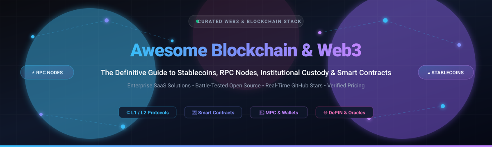

# Awesome-Blockchain-WEB3 🌐 ⛓️

  

  
  
  
  
  
  

## 🚀 Top Blockchain & Web3 Ecosystem

**A Curated List of SaaS Products & Open-Source GitHub Projects**  
*Focused on Stablecoin Infrastructure, Node RPC Services, Smart Contract Development, and Institutional Custody*

**Last updated: October 2026** 📅

---

### 📖 Introduction & SEO Overview

Welcome to the definitive **Awesome Blockchain & Web3** developer catalog! Whether you are engineering institutional stablecoin settlement rails, configuring high-throughput RPC node Supernodes, writing gas-optimized EVM smart contracts, or building multi-chain decentralized applications (dApps), this repository tracks notable **enterprise SaaS platforms** and **battle-tested open-source repositories**.

* **Keywords**: `blockchain`, `web3`, `smart-contracts`, `ethereum`, `solana`, `bitcoin`, `stablecoin-infrastructure`, `rpc-nodes`, `defi`, `mpc-wallets`, `foundry`, `hardhat`, `crypto-custody`, `chainlink`, `ipfs`

---

## 📑 Table of Contents

- [📊 Sector Overview & Market Dynamics](#-sector-overview--market-dynamics)
- [💼 SaaS / Hosted Platforms](#-saas--hosted-platforms)
- [🛠️ Open-Source GitHub Projects](#️-open-source-github-projects)
  - [🏆 Top Starred Frameworks & Blockchain Protocols](#-top-starred-frameworks--blockchain-protocols)
  - [🧱 Full-Stack Web3 Tooling & Complementary Libraries](#-full-stack-web3-tooling--complementary-libraries)
- [🤝 How to Contribute](#-how-to-contribute)
- [💖 Support & Sponsorship](#-support--sponsorship)
- [📈 Star History](#-star-history)
- [⚖️ Disclaimer](#️-disclaimer)

---

## 📊 Sector Overview & Market Dynamics

The global Web3 and blockchain infrastructure sector is estimated at **$10.2B in 2026** (growing at ~40% CAGR toward over $100B by 2032), operating alongside a stablecoin settlement market capitalization surpassing **$310B** with monthly transfer volumes nearing **$10T**. 

Market dynamics exhibit high consolidation in core settlement layers—featuring a "winner-take-most" duopoly in stablecoins (Tether and Circle controlling >83% market share)—while remaining moderately fragmented across developer tooling, node RPCs, and institutional custody providers competing on developer experience, multi-chain breadth, and regulatory compliance charters.

---

## 💼 SaaS / Hosted Platforms

Below is the verified breakdown of leading Web3 SaaS infrastructure providers, sorted in descending order by company size (valuation / annual revenue).

| Platform | Category & Description | Company Size (Valuation / Revenue) 🏢 | Pricing (Starting Paid Tier) 💳 | Free Tier Limits 🎁 |
| :--- | :--- | :--- | :--- | :--- |
| **[Tether (USDT)](https://tether.to/)** | 💵 Stablecoin Issuer & Reserve Network; largest stablecoin by market cap (~$183B+ liabilities). | **$350B–$375B** valuation (est. private/secondary) | **0.10%** acquisition fee; redemptions at **greater of $1,000 or 0.10%** ($100k account minimum) | Direct institutional issuance requires $100,000 minimum deposit (secondary market wallet transfers pay only native network gas) |
| **[Coinbase Cloud](https://www.coinbase.com/cloud)** | ☁️ Managed blockchain infrastructure, Node APIs, Pay SDK, and non-custodial wallet solutions. | **$47.0B** market cap (Nasdaq: COIN; ~$5.6B+ revenue) | **$0.005** per billed wallet operation beyond free allowance (pay-as-you-go) | **5,000 free wallet operations/month**; unlimited free read operations |
| **[Circle (USDC)](https://www.circle.com/)** | 🏦 Regulated stablecoin issuer (USDC/EURC), Programmable Wallets, and Web3 Services APIs. | **$20.5B** valuation (NYSE: CRCL; ~$2.8B revenue) | **$0.050/wallet** (All-Included) or **$0.038/wallet** (Signing API) for next 4k Monthly Active Wallets | **1,000 Monthly Active Wallets (MAWs)/month free forever**; free fiat tokenization (Circle Mint) |
| **[Alchemy](https://www.alchemy.com/)** | ⚡ Leading Web3 developer platform, Supernode RPC, Subgraphs, and Rollup infrastructure. | **$10.2B** valuation (Series C; ~$440M revenue) | **$49/month** (Growth Tier; 400M Compute Units/mo, up to 10k CUPS) | **30,000,000 Compute Units (CUs)/month free forever** (capped at 300 CUPS, 5 apps, 5 webhooks) |
| **[Chainalysis](https://www.chainalysis.com/)** | 🔍 Blockchain analytics, KYT (Know Your Transaction), Reactor, and investigation compliance data. | **$8.6B** valuation (peaked Series F; ~$140M–$190M ARR) | **$25,000/year** (single-user baseline module license; enterprise suites ~$100k+/year) | 14-day evaluation sandbox trial upon sales qualification |
| **[Fireblocks](https://www.fireblocks.com/)** | 🛡️ Institutional MPC custody, treasury management, and Fireblocks Network transfer rail. | **$8.0B** valuation (Series E; ~$120M–$150M revenue) | **$999/month** (Essentials Tier, up to $1M quarterly outbound volume cap; Enterprise starts at $36,000/year) | 30-day sandbox pilot/testnet evaluation trial for qualified institutional teams |
| **[Anchorage Digital](https://www.anchorage.com/)** | 🏛️ Federally chartered digital asset bank (OCC) offering custody, staking, and prime brokerage. | **$4.2B** valuation (Series D / strategic round; ~$85M revenue) | **$3,000/month minimum platform fee** or **~15–30 bps (0.15%–0.30%) AUC annually** | 30-day proof-of-concept institutional integration sandbox |
| **[Paxos](https://www.paxos.com/)** | 📜 NYDFS-regulated tokenization infrastructure; issuer of USDP, USDL, and partner for PayPal PYUSD. | **$2.4B** valuation (Series D; ~$143M revenue) | **0.12%–0.18%** trade execution fee ($1.75 minimum order fee via partner brokerage APIs) | Testnet developer sandbox access with free test minting and API testing keys |
| **[Infura](https://www.infura.io/)** | 🌐 Ethereum and IPFS RPC provider (ConsenSys); multi-chain endpoints, Gas API, and NFT SDK. | **$1.5B** valuation (ConsenSys parent Series D; peak $7.0B) | **$50/month** (Developer Tier; 15,000,000 daily credits, up to 2,000 credits/sec) | **3,000,000 daily credits/day free forever** (capped at 500 credits/sec, 1 active API key) |
| **[BitGo](https://www.bitgo.com/)** | 🔒 Multi-sig & MPC institutional digital asset custody, qualified trust custody, and wallets. | **$853M** valuation (NYSE: BTGO; ~$195M revenue) | **€2,500 setup fee** + **10–25 bps AUC annually** (requiring $1M/mo min volume threshold) | Testnet developer sandbox access (free API key on testnet environments) |

---

## 🛠️ Open-Source GitHub Projects

All open-source projects are sorted in **descending order by GitHub star count**. Beside each repository name, a social star badge directly links to that repository's stargazers page.

### 🏆 Top Starred Frameworks & Blockchain Protocols

- **[Bitcoin Core](https://github.com/bitcoin/bitcoin)**   
  🪙 **The reference implementation of the Bitcoin protocol** (MIT) — written in C++ with Proof-of-Work consensus. The bedrock foundation of decentralized digital money and the entire cryptocurrency ecosystem.

- **[Go Ethereum (Geth)](https://github.com/ethereum/go-ethereum)**   
  ⚡ **The official Go implementation of the Ethereum protocol** (LGPL-3.0) — the most widely deployed execution client for running full nodes, validator staking, contract deployment, and RPC interaction.

- **[OpenZeppelin Contracts](https://github.com/OpenZeppelin/openzeppelin-contracts)**   
  🛡️ **The standard library for secure smart contract engineering** (MIT) — battle-tested implementations of ERC-20, ERC-721, ERC-1155, account abstraction, timelocks, and upgradeable contracts securing hundreds of billions of dollars.

- **[Solidity](https://github.com/ethereum/solidity)**   
  📜 **The primary smart contract programming language for Ethereum Virtual Machine (EVM)** (GPL-3.0) — statically typed, contract-oriented language powering the vast majority of decentralized finance and token protocols.

- **[IPFS](https://github.com/ipfs/ipfs)**   
  📦 **Peer-to-peer hypermedia protocol** (MIT/Apache-2.0) — content-addressed, distributed file system designed for NFT metadata persistence, decentralized websites, and censorship-resistant data storage.

- **[Web3.js](https://github.com/web3/web3.js)**   
  💻 **Collection of TypeScript/JavaScript libraries for Ethereum RPCs** (LGPL-3.0) — the pioneering client library for connecting frontend applications to EVM nodes, accounts, and smart contracts.

- **[Hyperledger Fabric](https://github.com/hyperledger/fabric)**   
  🏢 **Enterprise-grade permissioned distributed ledger framework** (Apache-2.0) — modular blockchain architecture with pluggable consensus, private data collections, and high transaction throughput for institutional consortia.

- **[Solana](https://github.com/solana-labs/solana)**   
  🚀 **Web-Scale Layer-1 Blockchain** (Apache-2.0) — ultra-high-throughput, sub-second finality execution engine written in Rust utilizing Proof-of-History (PoH) and Sealevel parallel smart contract runtimes.

- **[Foundry](https://github.com/foundry-rs/foundry)**   
  🔥 **Blazing-fast, portable, and modular toolkit for Ethereum application development** (MIT/Apache-2.0) — written in Rust; features Forge (fuzz testing directly in Solidity), Cast (CLI Swiss Army knife), Anvil (local test node), and Chisel (REPL). The dominant smart contract development suite in modern Web3.

- **[Ethers.js](https://github.com/ethers-io/ethers.js)**   
  ✨ **Complete, compact Ethereum library and wallet implementation in JavaScript/TypeScript** (MIT) — cleanly designed abstractions for cryptographic signing, provider abstraction, and ABI interaction.

- **[Hardhat](https://github.com/NomicFoundation/hardhat)**   
  👷 **Flexible Ethereum development environment for professionals** (MIT) — compile, deploy, test, and debug EVM contracts with native TypeScript integration, console.log debugging, and extensive plugin ecosystem.

- **[Substrate](https://github.com/paritytech/substrate)**   
  🧱 **Modular Rust blockchain SDK** (Apache-2.0) — build sovereign, purpose-specific blockchains with customizable FRAME pallets, WASM runtimes, and native Polkadot/Kusama interoperability.

- **[Chainlink Core](https://github.com/smartcontractkit/chainlink)**   
  🔗 **Decentralized oracle network node** (MIT) — feeds smart contracts with tamper-proof real-world market prices, verifiable randomness (VRF), automation triggers, and cross-chain messaging (CCIP).

- **[Cosmos SDK](https://github.com/cosmos/cosmos-sdk)**   
  🌌 **Framework for building sovereign, interoperable application-specific blockchains** (Apache-2.0) — modular Golang framework powered by CometBFT consensus and Inter-Blockchain Communication (IBC).

- **[Wagmi](https://github.com/wevm/wagmi)**   
  ⚛️ **Reactive React and Vanilla JS hooks for Ethereum** (MIT) — intuitive wallet connectors, contract reads/writes, ENS resolution, and transaction simulation built on Viem.

- **[Reth](https://github.com/paradigmxyz/reth)**   
  🦀 **Modular, contributor-friendly, and blazing-fast Ethereum full node** (Apache-2.0/MIT) — written in Rust by Paradigm; implements Erigon-style staged sync for ultra-performant RPCs, MEV pipelines, and client diversity.

- **[Vyper](https://github.com/vyperlang/vyper)**   
  🐍 **Pythonic smart contract language for the EVM** (Apache-2.0) — designed for readability, formal auditability, and gas efficiency by eliminating inheritance and reentrancy vulnerabilities.

- **[Viem](https://github.com/wevm/viem)**   
  💡 **Lightweight, composable TypeScript interface for Ethereum** (MIT) — modern successor to Web3.js and Ethers v5 with tree-shaking, strict typing, and negligible bundle overhead.

- **[The Graph Node](https://github.com/graphprotocol/graph-node)**   
  📊 **Indexing node for querying blockchain data with GraphQL** (MIT) — builds custom subgraphs to extract, process, and cache events across Ethereum, Arbitrum, Optimism, and other chains.

- **[RainbowKit](https://github.com/rainbow-me/rainbowkit)**   
  🌈 **Polished wallet connection library for React** (MIT) — delightful out-of-the-box user experience supporting MetaMask, WalletConnect, Coinbase Wallet, Safe, and ledger hardware.

- **[Safe Smart Account](https://github.com/safe-global/safe-smart-account)**   
  🔐 **Core smart contracts for Safe (formerly Gnosis Safe)** (LGPL-3.0) — the gold standard multi-signature and account abstraction (ERC-4337) smart contract infrastructure securing billions in institutional digital assets.

- **[Scaffold-ETH 2](https://github.com/scaffold-eth/scaffold-eth-2)**   
  🏗️ **Open-source forkable Ethereum developer stack** (MIT) — instant full-stack dApp scaffolding combining Next.js, RainbowKit, Wagmi, Viem, and Foundry/Hardhat with contract hot-reload and burner wallets.

- **[Alloy](https://github.com/alloy-rs/alloy)**   
  ⚙️ **High-performance Rust toolkit for Ethereum** (MIT/Apache-2.0) — next-generation rewrite of ethers-rs by Paradigm providing robust primitives, JSON-RPC clients, and ABI encoders for Rust dApps and nodes.

- **[Ape Framework](https://github.com/ApeWorX/ape)**   
  🦍 **Modular Python smart contract development and testing framework** (Apache-2.0) — tailor-made for data scientists, security auditors, and Python developers targeting EVM networks.

- **[Moccasin](https://github.com/Cyfrin/moccasin)**   
  🧪 **Pythonic developer workflow for Vyper smart contracts** (MIT) — powered by Titanoboa and Cyfrin for seamless compilation, fuzz testing, and mainnet forking.

- **[Hardhat Ignition](https://github.com/NomicFoundation/hardhat-ignition)**   
  🚀 **Declarative deployment system for Hardhat** (MIT) — manages complex multi-contract EVM deployments, transaction recovery, and verification across testnets and production chains.

---

### 🧱 Full-Stack Web3 Tooling & Complementary Libraries

Build resilient, sovereign blockchain applications by composing the open-source Web3 stack:
* **Smart Contract Layer**: Write with [Foundry](https://github.com/foundry-rs/foundry) or [Hardhat](https://github.com/NomicFoundation/hardhat), backed by audited primitives from [OpenZeppelin Contracts](https://github.com/OpenZeppelin/openzeppelin-contracts).
* **Consensus & Execution Nodes**: Operate [Reth](https://github.com/paradigmxyz/reth) alongside [Go Ethereum](https://github.com/ethereum/go-ethereum) to guarantee network client diversity.
* **Frontend Interaction**: Connect users with [RainbowKit](https://github.com/rainbow-me/rainbowkit), orchestrate transactions with [Wagmi](https://github.com/wevm/wagmi) & [Viem](https://github.com/wevm/viem).
* **Data & Storage**: Query historical blocks via [The Graph Node](https://github.com/graphprotocol/graph-node), pin assets permanently with [IPFS](https://github.com/ipfs/ipfs), and consume external feeds via [Chainlink](https://github.com/smartcontractkit/chainlink).

---

## 🤝 How to Contribute

Contributions make the Web3 open-source community thrive! Follow these steps to submit additions or updates:

1. 🍴 **Fork the repo** to your GitHub profile.
2. 🌿 **Create a feature branch** (`git checkout -b feature/add-new-web3-tool`).
3. 📝 **Add/edit entries in `README.md`** following existing formatting (include name, repo link, star badge, license, and objective description).
4. 🚀 **Submit a Pull Request** with a concise summary of the project's utility and merit.

---

## 💖 Support & Sponsorship

If you find this curated collection valuable for your blockchain engineering, research, or enterprise operations:

* ⭐ **Star this repository** to help fellow developers discover it.
* 🍴 **Fork and share** the project with your Web3 community and colleagues.
* ☕ **Buy a coffee & sponsor ongoing maintenance** via the [GitHub Sponsor Dashboard](https://github.com/sponsors/ishandutta2007).

Thank you for supporting open-source blockchain intelligence! 🙌

---

## 📈 Star History

---

## ⚖️ Disclaimer

- This repository is a **community-curated index** — not financial advice, legal counsel, or commercial endorsement.
- Platforms handling digital assets and custody must comply with local **AML/KYC regulations, securities laws, and jurisdictional licensing requirements**.
- **Smart contract execution is irreversible**: always perform rigorous unit testing, fuzzing, formal verification, and external security audits prior to mainnet deployments.
- **Client diversity is a foundational security mandate**: running alternative execution and consensus clients (such as Reth alongside Geth) protects networks against catastrophic single-client consensus bugs.

---

  <b>Built with ❤️ for blockchain engineers, Web3 architects, and decentralized finance builders worldwide.</b>

